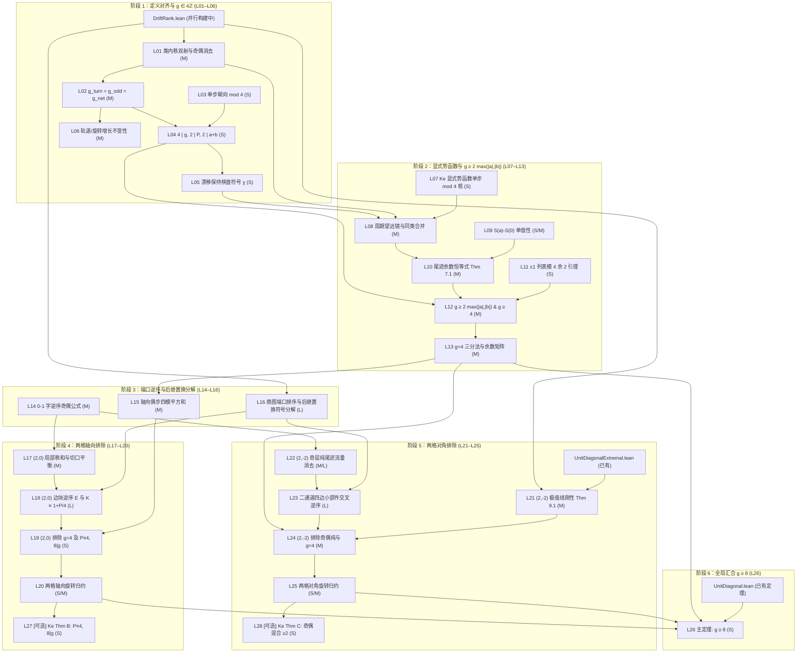

# 周期尾部增长定理（$g \ge 8$）：面向 Lean 4 的数学蓝图

更新日期：2026-11-22。仓库：`D:\langtonsant`（Lean 4.36.0，无 Mathlib）。

> **明确声明（范围与信任边界）：**
> 1. 本文是一份面向 Lean 4 形式化的**数学审阅与工程蓝图**，仅对文献中**已知**的周期尾部增长结论（Jillhewar 2026 与 Ke 2026）作跨来源对齐、证明审计与引理拆解，**没有证明任何新的数学定理**。
> 2. 本次任务为**只读研究**：没有新增、修改或编译任何 Lean 文件，没有运行 `lake build` 或任何外部 Python/Java/C++ 脚本，也没有产生新的提交。
> 3. **边界警示**：即便将本文规划的全部增长下界定理（$g \in 4\mathbb{Z}_{>0}$、$g \ge 2\max(|a|,|b|)$、$g=4$ 排除及最终的 $g \ge 8$，乃至可选的两格轴向 $8 \mid g, P \equiv 4 \pmod 8$ 与两格对角奇偶混合定理）在 Lean 4 中端到端形式化，它们也仅仅是白背景自洽字（`ConsistentWord`）与有限支撑周期尾部（`HighwayFrom`）的**必要条件**。**$g \ge 8$ 绝不解决 `ConsistentWordsAreStandard`**（例如它不能排除 $g \ge 8$ 的非标准周期候选，也不能替代固定漂移下的横向宽度控制或最小周期分类），更不触及第一开放块 `PeriodicTail` / `Ballistic` 或原始猜想 `HighwayConjecture`。

---

## 一、精确定义与跨来源词汇对齐

### 1.1 增长量 $g$ 在两份固定来源中的定义及其统一

固定核验的两份外部文献为：
- **Jillhewar (2026)**：`Atharva12456/langtons-ant-highway@76a7e234e577d992d086c204c3dea00ae72cf10a`，`paper/main.tex`（Definition 2.1, Lemma 2.5, Theorem 3.1, Proposition 5.4, Corollary 6.5, Theorem 7.1, Corollary 7.3, Theorem 7.5, Theorem 7.6, Theorem 9.1）。
- **Ke (2026)**：`kehao95/langtons-ant-core@b3429c25c33519c14f58f0a7171a857092bbd4cc`，`wake_synthesis/proof/periodic-growth-closure.md`（Sections 1–7, Theorems A–C）及其引用的 `wake_synthesis/PROOF.md`（Sections 1–2）。

两份来源使用了三种在表面上处于不同层次、但在自洽字（`ConsistentWord P w`）条件下严格等价的增长量 $g$ 定义：

1. **转向差定义（Turn-balance growth，Jillhewar Def 2.1 & Ke §1）**：
   在一个完整周期 $0 \le i < P$ 内，读白右转（`R`，本仓库 `w i = false`）与读黑左转（`L`，本仓库 `w i = true`）的次数之差：
   $$g_{\text{turn}}(P, w) := \#\{i < P \mid w(i) = \texttt{false}\} - \#\{i < P \mid w(i) = \texttt{true}\} = P - 2\cdot\#\{i < P \mid w(i) = \texttt{true}\}.$$
2. **奇数次访问的完整平移类计数（Odd full translation classes，Jillhewar Prop 5.4 & Ke §2.1）**：
   设单周期完整位移（full displacement，不可约分为本原方向）为 $v = \texttt{wordDrift } P\ w = (a,b) \neq (0,0)$。定义相位位置的完整周期平移等价关系：
   $$p \sim_v q \iff \exists k \in \mathbb{Z},\ p = q + k\cdot v.$$
   在商集 $\mathbb{Z}^2 / \mathbb{Z}v$ 中，每个完整平移类 $C$ 在一个周期内的访问重数（multiplicity）为 $m(C) = \#\{i < P \mid \texttt{wordPos } w\ i \in C\}$。称 $C$ 为**奇平移类（odd class）**，若 $m(C) \equiv 1 \pmod 2$。记奇平移类集合为 $\mathcal{O}$，则：
   $$g_{\text{odd}}(P, w) := |\mathcal{O}| = \#\bigl\{C \in (\mathbb{Z}^2/\mathbb{Z}v) \;\big|\; m(C) \bmod 2 = 1\bigr\}.$$
3. **每周期棋盘黑格净增长（Net black-cell trail growth，Jillhewar Lem 2.5 / Prop 5.4 & Ke §1）**：
   对任意有限支撑初态 $s$（`FiniteSupport s.board`）及其从时刻 $T$ 开始的周期尾部（`HighwayFrom s T P v`），记时刻 $t$ 棋盘上的黑格总数为 $|B_t|$，则对任意 $t \ge T$：
   $$g_{\text{net}}(s, t, P) := |B_{t+P}| - |B_t|.$$

**三者的调和与等价性证明机制（无需构造显式商集 $\mathbb{Z}^2/\mathbb{Z}v$）：**
- **避免商类型的去重代表选取**：在无 Mathlib 的 Lean 4 环境中，无需对 `Point` 构造 `Quotient`。对每个相位 $i < P$，其所在完整平移类 $C_i = \{\texttt{wordPos } w\ i + k\cdot v \mid k \in \mathbb{Z}\}$ 在本仓库拟建的 `DriftRank.lean`（由并行代理编写）中表示为等价谓词 `SameClass v (wordPos w i) (wordPos w j)`，其类内元素按稳定时间 $\tau_j = j - P\cdot \texttt{lift } v\ (\texttt{wordPos } w\ j)$ 严格全序排列。因此，**每个非空被访问平移类 $C$ 恰有一个稳定秩为 $0$（或最小相位下标）的典范代表相位 $i \in C$**；并且由于 `ConsistentWord` 要求第 $r$ 次稳定访问读色为 `decide (r % 2 = 1)`，一个类 $C$ 的总访问次数 $m(C)$ 为奇数，当且仅当该类中稳定秩最大（`lastInClass`）的相位读白（$r_{\max}$ 为偶数），也当且仅当该类的代表相位满足 `classPhases P w i` 长度为奇数。
- **逐类消去（$g_{\text{turn}} = g_{\text{odd}}$）**：在任意被访问类 $C$ 中，各相位按稳定秩 $r = 0, 1, \dots, m(C)-1$ 的读色严格交替为 $\texttt{false}, \texttt{true}, \texttt{false}, \texttt{true}, \dots$（即 `R, L, R, L, ...`）。因此：
  - 若 $m(C) = 2k$ 为偶数，类内恰有 $k$ 次 `R` 与 $k$ 次 `L`，贡献 $\#R - \#L = 0$；
  - 若 $m(C) = 2k+1$ 为奇数，类内恰有 $k+1$ 次 `R` 与 $k$ 次 `L`，贡献 $\#R - \#L = +1$。
  对所有被访问类求和，立即得到 $g_{\text{turn}}(P, w) = \sum_{C} (m(C) \bmod 2) = |\mathcal{O}| = g_{\text{odd}}(P, w)$。这一恒等式同时直接给出 $g \ge 0$ 以及 $2\cdot\#L \le P$。
- **与实际轨道黑格净增量的连接（$g_{\text{net}} = g_{\text{turn}}$）**：在每次单步转移 `step` 中，读白（`false`）将白格翻黑，使有限黑格基数 $+1$；读黑（`true`）将黑格翻白，使有限黑格基数 $-1$。因此任意 $P$ 步运行后的黑格净变化 $|B_{t+P}| - |B_t|$ 恒等于这 $P$ 步内的 $\#R - \#L$。

---

### 1.2 面向本仓库的 Lean 4 定义接口

遵循本仓库 `PeriodicWordCore.lean`、`UnitDiagonalRank.lean` 及并行构建中的通用漂移模块 `DriftRank.lean` 的命名规范，推荐使用**相位级无商集定义**作为主接口，使所有定理同时具备 `ConsistentWord`（字形式）与 `HighwayFrom`（轨道形式）两个版本：

```lean
namespace LangtonsAnt

/-- 周期内读黑（左转 L，`true`）的总次数。 -/
def leftCount (P : Nat) (w : Nat → Bool) : Nat :=
  ((List.range P).filter (fun i => w i)).length

/-- 周期内读白（右转 R，`false`）的总次数。 -/
def rightCount (P : Nat) (w : Nat → Bool) : Nat :=
  ((List.range P).filter (fun i => !w i)).length

/-- 转向差形式的有符号增长量 `g = #R - #L`（作为 `Int`）。 -/
def wordGrowthInt (P : Nat) (w : Nat → Bool) : Int :=
  (rightCount P w : Int) - (leftCount P w : Int)

/-- 与 phase `i` 属于同一完整 `wordDrift P w` 平移类的全部周期相位列表。
    当 `DriftRank.lean` 就绪后，可直接对齐 `classPhases P w i`。 -/
def sameClassPhases (P : Nat) (w : Nat → Bool) (i : Nat) : List Nat :=
  (List.range P).filter (fun j =>
    decide (∃ k : Int, wordPos w j = addPoint (wordPos w i) (scalePoint (wordDrift P w) k)))

/-- 相位 `i` 所在完整平移类是否被奇数次访问。 -/
def isOddClassPhase (P : Nat) (w : Nat → Bool) (i : Nat) : Bool :=
  decide ((sameClassPhases P w i).length % 2 = 1)

/-- 以稳定秩 0 作为每个被访问平移类的唯一典范代表，提取全部奇平移类的代表相位列表 `O`。
    避免构造 `Quotient`：每个奇平移类在 `oddClassReps P w` 中恰出现一次。 -/
def oddClassReps (P : Nat) (w : Nat → Bool) : List Nat :=
  (List.range P).filter (fun i =>
    decide ((priorPhases P w i).length = 0) && isOddClassPhase P w i)

/-- 自然数形式的增长量 `g = |O|`（奇平移类的个数）。 -/
def wordGrowth (P : Nat) (w : Nat → Bool) : Nat :=
  (oddClassReps P w).length

/-- 棋盘奇偶符号 `χ(x, y) = (-1)^(x+y)`，取值 `±1 : Int`。 -/
def checkerSign (p : Point) : Int :=
  if (p.1 + p.2) % 2 = 0 then 1 else -1

/-- 两格轴向完整漂移：`v ∈ {(±2, 0), (0, ±2)}`。 -/
def TwoCellAxialDrift (v : Point) : Prop :=
  ((v.1 = 2 ∨ v.1 = -2) ∧ v.2 = 0) ∨ (v.1 = 0 ∧ (v.2 = 2 ∨ v.2 = -2))

/-- 两格对角完整漂移：`v ∈ {(±2, ±2)}`。 -/
def TwoCellDiagonalDrift (v : Point) : Prop :=
  (v.1 = 2 ∨ v.1 = -2) ∧ (v.2 = 2 ∨ v.2 = -2)

end LangtonsAnt
```

**核心定理的建议顶层签名：**

```lean
/-- (i) g ∈ 4ℤ 且 g = #R - #L = |O|。 -/
theorem ConsistentWord.wordGrowthInt_eq_nat {P : Nat} {w : Nat → Bool}
    (h : ConsistentWord P w) :
    wordGrowthInt P w = (wordGrowth P w : Int)

theorem ConsistentWord.growth_mod_four {P : Nat} {w : Nat → Bool}
    (h : ConsistentWord P w) :
    wordGrowth P w % 4 = 0

/-- (ii) 股密度下界（Strand-density bound）：g ≥ 2 * max(|a|, |b|)，且 g > 0。 -/
theorem ConsistentWord.two_mul_driftInf_le_growth {P : Nat} {w : Nat → Bool}
    (h : ConsistentWord P w) :
    2 * max (wordDrift P w).1.natAbs (wordDrift P w).2.natAbs ≤ wordGrowth P w

theorem ConsistentWord.growth_pos {P : Nat} {w : Nat → Bool}
    (h : ConsistentWord P w) :
    0 < wordGrowth P w

/-- (iii) g = 4 的三分支排除（单位对角已由 `UnitDiagonal.consistentWord_not_unitDiagonal'` 完成）。 -/
theorem ConsistentWord.not_twoCellAxial_of_growth_four {P : Nat} {w : Nat → Bool}
    (h : ConsistentWord P w) (hd : TwoCellAxialDrift (wordDrift P w)) :
    wordGrowth P w ≠ 4

theorem ConsistentWord.not_twoCellDiagonal_of_growth_four {P : Nat} {w : Nat → Bool}
    (h : ConsistentWord P w) (hd : TwoCellDiagonalDrift (wordDrift P w)) :
    wordGrowth P w ≠ 4

/-- (iv) 综合增长下界：所有白背景自洽字满足 g ≥ 8，从而 P ≥ 8 + 2 * leftCount P w。 -/
theorem ConsistentWord.eight_le_growth {P : Nat} {w : Nat → Bool}
    (h : ConsistentWord P w) :
    8 ≤ wordGrowth P w

theorem periodic_tail_eight_le_growth {s : State} {T P : Nat} {v : Point}
    (hs : FiniteSupport s.board) (hP : 0 < P) (h : HighwayFrom s T P v) :
    8 ≤ wordGrowth P (fun i => readColor s (T + i))

/-- (可选扩展) Ke 的 Theorem B 与 Theorem C：对任意增长 g 均成立的两格漂移强约束。 -/
theorem ConsistentWord.twoCellAxial_period_and_growth_mod_eight {P : Nat} {w : Nat → Bool}
    (h : ConsistentWord P w) (hd : TwoCellAxialDrift (wordDrift P w)) :
    P % 8 = 4 ∧ wordGrowth P w % 8 = 0

theorem ConsistentWord.twoCellDiagonal_checker_mixed {P : Nat} {w : Nat → Bool}
    (h : ConsistentWord P w) (hd : TwoCellDiagonalDrift (wordDrift P w)) :
    2 ≤ ((oddClassReps P w).filter (fun i => decide (checkerSign (wordPos w i) = 1))).length ∧
    2 ≤ ((oddClassReps P w).filter (fun i => decide (checkerSign (wordPos w i) = -1))).length
```

---

## 二、来源证明的独立核验、隐含假设与形式化取舍

本节对 Jillhewar (`paper/main.tex`) 与 Ke (`periodic-growth-closure.md` 及 `PROOF.md`) 中的每一条相关证明作逐段独立审计，明确标出：**是否纯解析**、**是否存在隐含假设/纸面跳跃**、**外部脚本的角色**，以及**在 Lean 4 中的最优路线选择**。

### 2.1 $g \in 4\mathbb{Z}$ 与 $g > 0$（Jillhewar Lem 2.5, Prop 5.4, Thm 6.1, Cor 6.5 vs. Ke §2.1–2.3）

- **证明核验（纯解析，无计算依赖）**：
  1. **$g = |\mathcal{O}| \ge 0$**：来自同一平移类内按稳定时间排序后读色严格为 `R, L, R, L, ...`（首读为 `R`）。偶重数类贡献 $0$，奇重数类贡献 $1$。此步完全解析。
  2. **$4 \mid g$**：每步转向使朝向编号 $q \in \mathbb{Z}/4\mathbb{Z}$ 改变 $+1$（读白 `R`）或 $-1$（读黑 `L`）。一个周期后朝向恢复（`(wordTrace w P).2 = .north`），故 $\sum_{i<P} (\pm 1) = \#R - \#L = g \equiv 0 \pmod 4$。
  3. **$g > 0$ 的两条路线对比**：
     - *Jillhewar 第一路线（Sec 5.2 + Sec 6 Even-winding theorem）*：先由 Prop 5.4 / Cor 5.5 证明若 $g=0$ 则删去有限静止遗迹后可得到“干净平移子（clean finite translator）”，再用 Laurent 多项式守恒量（Prop 5.2）把漂移限制到轴向，最后在圆柱面 $C_L = (\mathbb{Z}/L\mathbb{Z})\times\mathbb{Z}$ 上计算绕数奇偶（Thm 6.1）导出矛盾。
     - *Jillhewar 第二路线（Cor 7.3）与 Ke 主路线（`periodic-growth-closure.md` §2.3）*：**完全跳过干净平移子与 Even-winding 定理**！直接利用带符号模 4 尾迹余数恒等式推出的股密度下界 $g \ge 2\max(|a|,|b|)$，结合 `ConsistentWord` 定义中已有的非零漂移条件 $v = (a,b) \neq (0,0)$，立即得出 $g \ge 2\cdot 1 = 2 > 0$；再与 $4 \mid g$ 结合即得 $g \in 4\mathbb{Z}_{>0}$。
- **形式化取舍**：**强烈建议采用 Ke / Jillhewar Cor 7.3 的直接路线**。这样在 Lean 4 中无需定义 $\mathbb{F}_2[X^{\pm 1}, Y^{\pm 1}]$ Laurent 多项式环，也无需形式化干净平移子与圆柱面绕数定理，依赖链缩短一半以上。

### 2.2 股密度下界 $g \ge 2\max(|a|,|b|)$（Jillhewar Prop 5.3, Lem 7.2, Thm 7.1, Cor 7.3 vs. Ke §2.2–2.3）

- **证明核验（纯解析，附带作者的独立有限回归脚本，但证明本身不依赖脚本）**：
  - *Jillhewar 的表述*：先在 Prop 5.3 中证明 $\mathbb{Z}/4\mathbb{Z}$ 上的四角上同调条件（four-corner cocycle condition）保证朝向修正项 $F_q$ 存在（通过沿两个对角子格积分并验证菱形环路积分为 0），再结合算子分解 $D = S + (T_d - 1)A$（Prop 5.4）消去移动部件 $A$。
  - *Ke 的显式规范势函数改写（`periodic-growth-closure.md` §2.2 Eq. (1)–(2)）*：**消除了上同调存在性引理与路径积分良定义性检查**。对任意函数 $f : \mathbb{Z} \to \mathbb{Z}$ 及满足递推
    $$S(x+1) - S(x) = f(x) + f(x+1)$$
    的整数序列 $S : \mathbb{Z} \to \mathbb{Z}$（取 $S(0)=0$），直接在整数（模 4）上显式给出四个朝向的头部修正项（记 $c = \chi(x,y) \in \{\pm 1\}$）：
    $$F_N(x,y) = -c\,S(x),\quad F_E(x,y) = c\bigl(S(x)-f(x)\bigr),\quad F_S(x,y) = -c\bigl(S(x)+2f(x)\bigr),\quad F_W(x,y) = c\bigl(S(x)+f(x)\bigr).$$
    记第 $i$ 步转向符号为 $\delta_i \in \{+1 (\text{R}), -1 (\text{L})\}$，当前位置为 $p_i = (x_i, y_i)$，朝向为 $h_i$。单步不变量检验表明：对所有 4 种朝向与 2 种读色（共 8 种情况），
    $$\Delta_i := F_{h_{i+1}}(p_{i+1}) - F_{h_i}(p_i) + \delta_i\,\chi(p_i)\,f(x_i) \in \{0,\ 4\,\chi(p_i)\,f(x_i)\},$$
    因而在模 4 下**恒等于 0**！
  - *单周期求和与余数单值性（Monodromy，Eq. (3)–(4)）*：
    在 `wordTrace` 的一个周期 $0 \le i < P$ 上对 $\Delta_i \equiv 0 \pmod 4$ 求和：
    1. 头部项望远镜相消为 $F_N(a,b) - F_N(0,0) = -\chi(a,b)S(a) + S(0) = -S(a)$（因 $P$ 为偶数，故 $a+b$ 为偶数，$\chi(a,b) = \chi(0,0) = 1$）。
    2. 场项（field sum）按完整平移类分组：当 $a \neq 0$ 且取 $f(x)$ 以 $|a|$ 为周期时，由于 $a+b$ 为偶数，$\chi(p)\cdot f(p_x)$ 在同一完整平移类 $p + \mathbb{Z}(a,b)$ 上是**常数**！而在每个平移类内部，$\sum_{i \in C} \delta_i = \#R_C - \#L_C$ 恰为奇平移类指示函数 $\mathbf{1}_{C \in \mathcal{O}}$。故场项之和精确简化为 $\sum_{i \in \texttt{oddClassReps}} \chi(p_i) f(x_i)$（完全不需要单独形式化 Jillhewar Prop 5.4 的无穷网格算子分解 $D = S + (T_d-1)A$！）。
    3. 当 $a \neq 0$ 且 $f$ 以 $|a|$ 为周期时，$S(a) - S(0) = 2\operatorname{sgn}(a)\sum_{r=0}^{|a|-1} f(r)$，模 4 下 $-S(a) \equiv 2\sum_{r=0}^{|a|-1} f(r) \pmod 4$。取 $f$ 为单个余数类 $r \in \{0,\dots,|a|-1\}$ 的指示函数，即得对每个 $r \bmod |a|$：
       $$\sum_{\substack{i \in \mathcal{O} \\ x_i \equiv r \pmod{|a|}}} \chi(p_i) \equiv 2 \pmod 4.$$
    4. 当 $a = 0$ 时，$F_N(0,b) - F_N(0,0) = 0$，且平移 $(0,b)$ 保持列坐标 $x$ 不变；对任意固定列 $x_0 \in \mathbb{Z}$ 取指示函数 $f(x) = \mathbf{1}_{x = x_0}$，即得精确列守恒式（Eq. (4)）：
       $$\sum_{\substack{i \in \mathcal{O} \\ x_i = x_0}} \chi(p_i) \equiv 0 \pmod 4.$$
    5. 对 $y$ 坐标（可通过对字施加四分之一转旋转归约到 $x$ 坐标，或直接写出关于 $y$ 的对称势函数）同样成立。
    6. 由于若干个 $\pm 1$ 之和若模 4 余 2，则项数必为正偶数，因而不小于 2。故当 $a \neq 0$ 时每个模 $|a|$ 余数纤维至少有 2 个奇平移类，给出 $g \ge 2|a|$；同理 $b \neq 0$ 时 $g \ge 2|b|$，合并即得 $g \ge 2\max(|a|,|b|)$。
- **隐含假设审计**：
  - 无实质漏洞。唯一需要在 Lean 中显式写明的是：**必须先由 `(wordTrace w P).2 = .north` 证明 $P$ 为偶数，进而由 `wordPos_parity` 推出漂移分量满足 $(a+b) \bmod 2 = 0$**，否则平移 $v=(a,b)$ 不能保持棋盘符号 $\chi(x,y)$。

### 2.3 $g=4$ 时的三类漂移分类与单位对角排除

- **证明核验（纯解析算术 + 已形式化定理）**：
  - 若 $g < 8$，由 $4 \mid g$ 与 $g > 0$ 知必有 $g = 4$。
  - 由 $4 = g \ge 2\max(|a|,|b|)$ 得 $|a| \le 2$ 且 $|b| \le 2$。
  - 结合 $(a,b) \neq (0,0)$ 与 $a+b \equiv 0 \pmod 2$，满足条件的整点 $(a,b) \in [-2,2]^2$ 恰有 **12 个**，按四分之一转旋转精确划分为三个 4 元轨道：
    1. **单位对角（Unit diagonal）**：$v \in \{(\pm 1, \pm 1)\}$（`UnitDiagonalDrift v`）。**本仓库已在 `UnitDiagonal.lean` 中完成纯内核无条件排除**（`UnitDiagonal.consistentWord_not_unitDiagonal'` 与 `UnitDiagonal.no_unit_diagonal_periodic_tail'`）。
       *注*：Ke 在 `periodic-growth-closure.md` §5 中提到其旧版 12,884 分支局部枚举证书，但同时也提供了纯解析三层交错证明 `unit_diagonal_analytic/PROOF.md`；本仓库已将后者完整形式化为纯内核证明，因此这一支在 Lean 中**零计算依赖、已关闭**。
    2. **两格轴向（Two-cell axial）**：$v \in \{(\pm 2, 0), (0, \pm 2)\}$（`TwoCellAxialDrift v`）。
    3. **两格对角（Two-cell diagonal）**：$v \in \{(\pm 2, \pm 2)\}$（`TwoCellDiagonalDrift v`）。

### 2.4 两格轴向漂移排除（Jillhewar Thm 7.5 vs. Ke §3 Theorem B）

- **证明核验（纯解析，但含高风险置换奇偶步骤）**：
  - 将漂移通过旋转归一化到 $v = (2, 0)$（利用本仓库已有的 `ConsistentWord.exists_phase_dir` 可将起始相位选为垂直入射 `.north`，此时棋盘/轴扇区固定）。记 $P = 2M$。由于水平移动与垂直移动交替，共有 $M$ 次水平移动，总水平位移为 $2$，故 $M$ 必为偶数，从而 $4 \mid P$。
  - 在每一行 $y \in \mathbb{Z}$ 上，模 $(2,0)$ 恰有两个完整平移类：垂直入射类 $Q_y$（偶 $x+y$）与水平入射类 $C_y$（奇 $x+y$）。
  - 定义左转稳定秩模 2 之和：
    $$K := \sum_{i < P,\, w(i) = \texttt{true}} \texttt{stableRank}(i) \pmod 2.$$
  - **两部分的对比**：
    - *第一部分（运动学秩分解恒等式 $K \equiv 1 + P/4 \pmod 2$，Jillhewar Eq. (20) / Ke Eq. (7)）*：
      将相位后继映射 `succ P`（单个长度为偶数 $P$ 的循环，作为 $P$ 元置换的逆序奇偶号为 $1 \pmod 2$）分解为：“按每个类内的出射端口位 $\beta$ 稳定排序 $\to$ 沿有向商边保序匹配 $\to$ 按每个类内的入射端口位 $\alpha$ 逆排序”。
      利用 0-1 字逆序数公式 $\operatorname{inv}(\alpha) \equiv A(n-1) + \sum_{r=0}^{n-1} r\alpha_r + \binom{A}{2} \pmod 2$，所有正向有向边的 $\binom{A}{2}$ 项在源端与目的端成对抵消；剩余局部线性项与商图边块置换逆序数 $E = \sum_y h_y(s_y+s_{y+1}) + n_y(s_{y+1}+s_{y+2}) \equiv \sum_y n_y + \sum_y n_y n_{y+1} \pmod 2$ 相加后，$\sum_y \binom{h_y}{2} \equiv \sum_y n_y n_{y+1} \pmod 2$ 精确抵消，留下 $\sum_y n_y = M/2 = P/4 \pmod 2$，从而得出 $K \equiv 1 + P/4 \pmod 2$。
    - *第二部分（自洽字的算术矛盾，Ke §3.1 对任意 $g$ 的推广 vs. Jillhewar $g=4$ 特例）*：
      在自洽字中，所有读黑左转（`w i = true`）均发生在奇数稳定秩（`stableRank % 2 = 1`），故
      $$K \equiv \#L = \frac{P - g}{2} \pmod 2.$$
      由于 $4 \mid P$ 且 $4 \mid g$，$(P-g)/2$ 必为偶数！因此自洽字恒有 **$K \equiv 0 \pmod 2$**。
      代入 $K \equiv 1 + P/4 \pmod 2$，**对任意增长 $g$ 的两格轴向自洽字，立即无条件推出 $P/4 \equiv 1 \pmod 2$，即 $P \equiv 4 \pmod 8$（进而 $M = P/2 \equiv 2 \pmod 4$）**！
      再看奇平移类在每一行 $y$ 上的分布：行 $y$ 仅有 $Q_y$ 与 $C_y$ 两个类，它们的棋盘符号相反（$\chi(Q_y) = +1, \chi(C_y) = -1$）。由精确行余数式（Eq. (4)，$b=0$ 时对行 $y$ 的有符号和模 4 余 0）：
      $$\mathbf{1}_{Q_y \in \mathcal{O}} - \mathbf{1}_{C_y \in \mathcal{O}} \equiv 0 \pmod 4.$$
      由于左边取值于 $\{-1, 0, +1\}$，必有 $\mathbf{1}_{Q_y \in \mathcal{O}} = \mathbf{1}_{C_y \in \mathcal{O}}$！即每一行上的两个类要么同为奇类，要么同为偶类。因此落在 $Q$ 类（垂直入射偶步）上的奇类总数恰为 $A_0 = g/2$。
      最后，将 $P=2M$ 步按偶数步（垂直入射、水平出射，共 $M$ 步）配对：设第 $j$ 对的水平步方向符号为 $u_j \in \{\pm 1\}$（东 $+1$，西 $-1$），垂直入射方向符号为 $v_j \in \{\pm 1\}$（北 $+1$，南 $-1$）。则偶数步的转向符号（`R` 为 $+1$，`L` 为 $-1$）恰为 $u_j v_j$！
      对所有 $M$ 个偶数步（即全部 $Q$ 类事件）求和：
      - $\sum_{j=0}^{M-1} u_j v_j = \sum_{y} (\#R_{Q_y} - \#L_{Q_y}) = A_0 = g/2$；
      - $\sum_{j=0}^{M-1} u_j = \text{水平总位移} = 2$；
      - $\sum_{j=0}^{M-1} v_j = \text{垂直总位移} = 0$（因循环移位后垂直入射符号列表与垂直出射步符号列表相同）。
      由于 $u_j, v_j \in \{\pm 1\}$，每一项 $(1+u_j)(1+v_j) \in \{0, 4\}$，故模 4 下：
      $$0 \equiv \sum_{j=0}^{M-1} (1+u_j)(1+v_j) = M + \sum u_j + \sum v_j + \sum u_j v_j = M + 2 + 0 + \frac{g}{2} \pmod 4.$$
      因为已证 $M \equiv 2 \pmod 4$，代入得 $2 + 2 + g/2 \equiv 0 \pmod 4$，即 **$g/2 \equiv 0 \pmod 4 \implies 8 \mid g$**！
      这不仅一步排除了 $g=4$，而且几乎不增加任何额外证明成本就同时给出了 Ke 的 Theorem B（$P \equiv 4 \pmod 8$ 且 $8 \mid g$）。
- **隐含假设审计**：
  1. **归一化前提**：证明假定第 $0$ 步是垂直入射（从而偶数步都在 $Q_y$、奇数步都在 $C_y$）。在 Lean 中，不能直接对原始 `ConsistentWord` 假定这一点（虽然 `wordTrace w 0` 朝北已是垂直入射！注意：本仓库 `wordTrace w 0` 固定从 `(0,0)` 朝 `.north` 出发，**天然满足第 0 步为垂直入射 `.north` 且位于偶格 `(0,0)`**！这是一个极大的形式化便利：只要在旋转归约时将轴向漂移旋转到 `wordDrift P w = (2, 0)`，第 0 步就已经在原点朝北，无需任何额外的相位平移！）。
  2. **跨接缝的保序匹配**：在阶段 $P-1 \to 0$ 跨越周期接缝时，`wordPos w P = (2, 0)` 提供进位 $\delta = 1$，使稳定时间差 $\tau_{\text{succ}(i)} - \tau_i = 1 - P\cdot \text{voltage}$ 仅依赖有向商边类型而与是否跨接缝无关。这一点将由 `DriftRank.lean` 的通用有向边保序匹配定理严格保证。
  3. **有限支撑求和的区间截断**：纸面证明对“所有行 $y \in \mathbb{Z}$”写无穷级数 $\sum_{y \in \mathbb{Z}}$。在 Lean 4 中应取 `Ymin .. Ymax`（覆盖一个周期内所有访问格的 $y$ 坐标上下界再外扩 2 行），在显式有限区间 `List.range` 上做代数化简。

### 2.5 两格对角漂移排除（Jillhewar Thm 7.6 & Thm 9.1 vs. Ke §4 Theorem C）

- **证明核验（纯解析，Ke 的版本通过 Thm 9.1 省去了一半情况）**：
  - 旋转归一化到 $v = (2, -2)$。由于 `wordTrace w 0` 从 `(0,0)` 朝 `.north`（垂直入射）出发，层坐标 $t = x+y$ 与通道（lane）余数 $r = x \bmod 2 \in \{0, 1\}$ 完全确定商类 $(t, r)$：偶层 $t$ 为垂直入射类 $Q_{t,r}$（$\chi = +1$），奇层 $t$ 为水平入射类 $C_{t,r}$（$\chi = -1$）。
  - **为什么 $g=4$ 迫使奇类集合 $\mathcal{O}$ 棋盘奇偶纯（checker-pure）**：
    按 $(x \bmod 2, y \bmod 2) \in \{0,1\}^2$ 统计 4 个奇平移类的分布矩阵 $\begin{bmatrix} n_{00} & n_{01} \\ n_{10} & n_{11} \end{bmatrix}$。
    由余数定理（Eq. (3)），每个 $x$ 纤维（行）与每个 $y$ 纤维（列）的有符号 $\chi$ 之和均满足 $\equiv 2 \pmod 4$。因总和为 $g=4$，每行、每列恰有 2 个奇类，且同一行（或同一列）的 2 个奇类必须具有相同的棋盘符号 $\chi$（否则 $+1 + (-1) = 0 \not\equiv 2 \pmod 4$）。因此分布矩阵只能是
    $$\begin{bmatrix} 2 & 0 \\ 0 & 2 \end{bmatrix} \quad (\text{全在偶层 } Q,\ \chi = +1) \qquad\text{或}\qquad \begin{bmatrix} 0 & 2 \\ 2 & 0 \end{bmatrix} \quad (\text{全在奇层 } C,\ \chi = -1),$$
    且两个通道 $r=0, 1$ 各有 $o_0 = 2, o_1 = 2$ 个奇类（对任意 $g$ 的纯奇偶尾迹，Eq. (3) 同样给出 $o_0 \equiv o_1 \equiv 2 \pmod 4$）。
  - **Ke 的关键简化（利用极值线刚性 Jillhewar Thm 9.1 直接排除“$\mathcal{O}$ 全在偶层 $Q$”）**：
    在 Jillhewar Thm 7.6 的原证明中，作者分别对“$\mathcal{O} \subseteq C$（four-edge gadget $G^C_{j,r}$）”和“$\mathcal{O} \subseteq Q$（four-edge gadget $G^Q_{j,r}$）”做了两套平行的四边小部件逆序表推导。
    而 Ke 在 `periodic-growth-closure.md` §4 第一段指出：**由横向极值线刚性（Jillhewar Thm 9.1），在当前坐标系（`wordTrace` 起点在偶层 $0$ 垂直入射）下，横向最大层 $T_{\max}$ 与最小层 $T_{\min}$ 上的所有被访问类都必须是水平入射（奇层 $C$）、仅访问 1 次且读白（`R`）的单元素类（singleton odd class）**！
    证明与本仓库 `UnitDiagonalExtremal.lean` 的 `topLayer_unique_phase` 完全同构：在最大层 $T_{\max}$ 上，前驱来自 $T_{\max}-1$（故入射必为 `.north` 或 `.east`），后继去往 $T_{\max}-1$（故出射必为 `.south` 或 `.west`）。若 $T_{\max}$ 为偶层（垂直入射），则每次到达必朝 `.north`；首访（秩 0）读白右转后将朝 `.east` 进入 $T_{\max}+1$，矛盾！因此 $T_{\max}$（以及同理 $T_{\min}$）必为奇层（水平入射 $C$），且该层上任何非空平移类的秩 0 事件读白（`.east` 入、`.south` 出），若存在秩 1 事件则读黑（`.east` 入、`.north` 出进入 $T_{\max}+1$，矛盾），故极值层上的每个被访问类都是重数为 1 的奇类！
    **推论**：$\mathcal{O}$ 必然包含至少一个奇层 $C$ 上的类（实际上极值层至少贡献 2 个奇层奇类）。因此，**“$\mathcal{O}$ 全在偶层 $Q$”在第一步就已经被极值层刚性直接否定**！我们只需要对“$\mathcal{O} \subseteq C$（所有偶层 $Q$ 的重数均为偶数，即 $D_Q = 0$）”证明一次二通道秩奇偶恒等式 $K \equiv 1 + \sum_{r=0}^1 \binom{o_r}{2} \pmod 2$，即可同时完成 $g=4$ 的两格对角排除与 Ke 的 Theorem C（任意 $g$ 下奇类必混合两种棋盘奇偶，且每种至少 2 个）！
- **隐含假设审计**：
  - 在二通道秩奇偶证明中，$Q_{t,r}$ 的重数为偶数（$D_{Q_{t,r}} = 0$），故其西出射与东出射的模 2 计数相等：$w_{t,r} \equiv e_{t,r} =: a_{t,r} \pmod 2$。结合切口流量平衡 $w_{t,r}+e_{t,r} = s_{t+1,r}+n_{t-1,r}$ 得 $s_{j,r} \equiv n_{j-2,r} \pmod 2$，再代入奇层平衡式得 $a_{t,r} + n_{t-1,1-r} = a_{t+2,r} + n_{t+1,1-r} \pmod 2$。由于轨迹有界（在极值层之外 $a_{t,r} = n_{j,r} = 0$），向下归纳即得 $a_{t,r} \equiv n_{t-1,1-r} \pmod 2$。这一步在 Lean 中需在覆盖轨迹层范围的有限整数区间上由外向内做步长为 2 的归纳。

---

## 三、编号引理依赖图（Lemma DAG）、难度评估与工具包复用

以下共设计 **28 个引理（L01–L28）**，其中 L01–L26 构成目标 (i)–(iv)（直到 $g \ge 8$）的完整闭环，L27–L28 为 Ke 的两项全增长附加定理（可选，但在我们的证明结构下只是 L21–L24 的零成本推论）。

**难度分级说明**：
- **S（Small）**：局部代数、有限情况分类（`cases` / `decide` / `omega`）或现有定理的直接包装。
- **M（Medium）**：单重列表归纳、模算术求和、已有稳定秩接口的组合调用。
- **L（Large）**：跨周期/跨类的全局双射、置换逆序数分解或二通道边块交叉计数。

**稳定秩工具包复用标记**：
- `[Reuse: Existing]`：直接调用 `PeriodicWordCore.lean`、`PeriodicWord.lean`、`RecordPair.lean`、`UnitDiagonal*.lean` 中已有的定义或定理。
- `[Reuse: DriftRank]`：直接调用并行代理正在编写的通用漂移稳定秩模块 `DriftRank.lean`（包含任意非零漂移 $v$ 下的 `SameClass`、`lift`、`stableTime`、`stableRank`、首次物理返回 $\implies \text{rank}+1$、以及固定有向格边上的稳定时间/稳定秩保序匹配）。

### 3.1 第一阶段：增长量定义对齐、类内交替与 $g \in 4\mathbb{Z}$（L01–L06）

#### L01：类内稳定秩双射与奇偶计数消去
- **结论**：在 `ConsistentWord P w` 下，对任意相位 $i < P$，其所在完整平移类 `classPhases P w i` 的稳定秩映射 `stableRank P w` 是到 `List.range (classPhases P w i).length` 的双射；类内读白次数与读黑次数满足：
  $$\texttt{classRightCount}(i) = \texttt{classLeftCount}(i) + (\texttt{classPhases } P\ w\ i).\texttt{length} \bmod 2.$$
- **依赖**：`ConsistentWord` 定义；`[Reuse: DriftRank]`（任意漂移下 `stableRank` 在同类相位上的单射与满射，对应 `UnitDiagonalMatching.lean` 中 `stableRank_injective_on_layer` 与 `stableRank_surjective_on_layer` 的通用版）。
- **难度**：**M**。

#### L02：三种增长量定义的精确等价（$g_{\text{turn}} = g_{\text{odd}} = g_{\text{net}}$）
- **结论**：对任意 `ConsistentWord P w`，有 `P = rightCount P w + leftCount P w` 以及
  $$\texttt{wordGrowthInt } P\ w = (\texttt{wordGrowth } P\ w : \text{Int}), \qquad P = 2 \cdot \texttt{leftCount } P\ w + \texttt{wordGrowth } P\ w.$$
  从而 $g = \texttt{wordGrowth } P\ w \ge 0$。此外，对有限支撑状态 $s$ 的周期运行，单周期内翻转后的黑格列表净基数变化等于 `wordGrowth P w`。
- **依赖**：L01，`[Reuse: Existing]` `board_visit_parity`。
- **证明要点**：按秩 $0$ 代表 `oddClassReps P w` 将 `List.range P` 划分为互不相交的平移类，对每类应用 L01 求和。
- **难度**：**M**。

#### L03：单步朝向四周期编码与转向增量
- **结论**：定义朝向编码 `dirCode : Direction → Int`（`.north ↦ 0, .east ↦ 1, .south ↦ 2, .west ↦ 3`）及转向步长 `turnSign (b : Bool) : Int := if b then -1 else 1`。则对任意 $c : \text{Bool}$ 和 $d : \text{Direction}$，有：
  $$(\texttt{dirCode (turn } c\ d) - \texttt{dirCode } d) \bmod 4 = \texttt{turnSign } c \bmod 4.$$
- **依赖**：`turn` 定义。
- **证明要点**：`cases c <;> cases d <;> decide`。
- **难度**：**S**。

#### L04：朝向复原推出 $g \equiv 0 \pmod 4$ 及 $P$ 与 $a+b$ 均为偶数
- **结论**：若 `ConsistentWord P w` 且 $v = \texttt{wordDrift } P\ w = (a,b)$，则：
  1. `wordGrowth P w % 4 = 0`；
  2. `P % 2 = 0` 且 `(a + b) % 2 = 0`；
  3. `(leftCount P w) % 2 = 0 ↔ P % 4 = (wordGrowth P w) % 8 / ...`（特别地，当 $4 \mid P$ 且 $4 \mid g$ 时，`leftCount P w % 2 = 0`）。
- **依赖**：L02、L03；`[Reuse: Existing]` `ConsistentWord.even`、`linearForm_wordPos_parity`（`RecordPair.lean`）。
- **证明要点**：对 $0 \le n \le P$ 归纳证明 `dirCode (wordTrace w n).2 ≡ ∑_{i<n} turnSign (w i) (mod 4)`；在 $n=P$ 时左端为 `dirCode .north = 0`，右端为 `wordGrowthInt P w`。
- **难度**：**S**。

#### L05：完整漂移平移保持棋盘奇偶符号 $\chi$
- **结论**：当 $(a+b) \bmod 2 = 0$ 时，对任意 $p : \text{Point}$ 和 $k : \text{Int}$，有：
  $$\texttt{checkerSign (addPoint } p\ (\texttt{scalePoint } (a,b)\ k)) = \texttt{checkerSign } p.$$
- **依赖**：L04，`checkerSign` 定义。
- **证明要点**：`omega`。
- **难度**：**S**。

#### L06：轨道形式与字形式的增长量传递
- **结论**：若 `FiniteSupport s.board`、`0 < P` 且 `HighwayFrom s T P v`，则对任意相位偏移 $a : \text{Nat}$，字 `w_a := fun i => readColor s (T + a + i)` 满足 `ConsistentWord P w_a`，且 `wordGrowth P w_a = wordGrowth P (fun i => readColor s (T + i))`，其字漂移为 `rotatePoint (inverseRotation (run s (T + a)).dir) v`。
- **依赖**：`[Reuse: Existing]` `periodic_tail_consistent_at_start`、`UnitDiagonal.wordDrift_of_highway`（`UnitDiagonalReduction.lean`）。
- **难度**：**M**。

---

### 3.2 第二阶段：显式模 4 势函数、尾迹余数定理与 $g \ge 2\max(|a|,|b|)$（L07–L13）

#### L07：Ke 的显式整数势函数单步模 4 守恒核
- **结论**：给定任意函数 $f : \text{Int} \to \text{Int}$ 及满足 $\forall x,\ S(x+1) - S(x) = f(x) + f(x+1)$ 的函数 $S : \text{Int} \to \text{Int}$。定义头部修正项 `headPot f S (p : Point) (d : Direction) : Int` 为（记 $c = \texttt{checkerSign } p$）：
  - `.north ↦ -c * S p.1`
  - `.east  ↦  c * (S p.1 - f p.1)`
  - `.south ↦ -c * (S p.1 + 2 * f p.1)`
  - `.west  ↦  c * (S p.1 + f p.1)`
  则对任意位置 $p$、朝向 $d$ 和读色 $b : \text{Bool}$，令 $d' = \texttt{turn } b\ d$，$p' = \texttt{move } p\ d'$，有：
  $$\bigl(\texttt{headPot } f\ S\ p'\ d' - \texttt{headPot } f\ S\ p\ d + \texttt{turnSign } b \cdot \texttt{checkerSign } p \cdot f(p.1)\bigr) \bmod 4 = 0.$$
- **依赖**：`move`、`turn`、`checkerSign` 定义。
- **证明要点**：对 $d$（4 种）、$b$（2 种）及 $(p.1 + p.2) \bmod 2$（2 种）分 16 种情形展开；注意到 $\texttt{checkerSign } p' = -\texttt{checkerSign } p$，东移用 $S(x+1) = S(x)+f(x)+f(x+1)$，西移用 $S(x-1) = S(x)-f(x-1)-f(x)$，北/南移 $x$ 不变，由 `omega` 直接证毕。**完全避开 Jillhewar Prop 5.3 的四角上同调积分存在性证明。**
- **难度**：**S**。

#### L08：沿字轨迹的势函数望远镜求和与同类合并
- **结论**：在 `ConsistentWord P w` 下，若 $f : \text{Int} \to \text{Int}$ 沿漂移 $x$-分量周期不变（即 $\forall x,\ f(x + a) = f(x)$，其中 $(a,b) = \texttt{wordDrift } P\ w$），则：
  $$\left(\sum_{i \in \texttt{oddClassReps } P\ w} \texttt{checkerSign}(\texttt{wordPos } w\ i)\cdot f((\texttt{wordPos } w\ i).1) - S(a) + S(0)\right) \bmod 4 = 0.$$
- **依赖**：L01、L04、L05、L07。
- **证明要点**：将 L07 从 $i=0$ 到 $P-1$ 求和，头部项望远镜相消为 $\texttt{headPot } f\ S\ (a,b)\ \texttt{.north} - \texttt{headPot } f\ S\ (0,0)\ \texttt{.north} = -(S(a) - S(0))$；场项由于 $\chi(p_i) f(x_i)$ 在同一完整平移类上恒定（L05 及 $f$ 的 $a$-周期性），按平移类分组后，由 L01 每个偶类内 $\sum \texttt{turnSign} = 0$、每个奇类内 $\sum \texttt{turnSign} = 1$，直接化为对 `oddClassReps P w` 的求和。
- **难度**：**M**。

#### L09：周期函数的 $S(a) - S(0)$ 单值性公式（Monodromy）
- **结论**：若 $a \neq 0$ 且 $f : \text{Int} \to \text{Int}$ 以 $|a|$ 为周期，取 $S(0)=0$ 且 $S(x+1)-S(x)=f(x)+f(x+1)$，则：
  $$(S(a) - S(0)) \bmod 4 = \left(2 \cdot \sum_{r \in \texttt{List.range } a.\texttt{natAbs}} f(r)\right) \bmod 4.$$
  若 $a = 0$，则 $S(a) - S(0) = 0$。
- **依赖**：整数周期和归纳。
- **证明要点**：对 $|a|$ 步求和，$\sum_{k=0}^{|a|-1} (f(k) + f(k+1)) = 2\sum_{r=0}^{|a|-1} f(r) + f(|a|) - f(0) = 2\sum_{r=0}^{|a|-1} f(r)$；当 $a < 0$ 时符号为 $-2 \equiv 2 \pmod 4$。
- **难度**：**S/M**。

#### L10：带符号模 4 尾迹余数恒等式（Jillhewar Thm 7.1 / Ke Eq. (3)–(4)）
- **结论**：设 `ConsistentWord P w` 的漂移为 $v = (a,b)$：
  1. 若 $a \neq 0$，则对每个余数 $r < a.\texttt{natAbs}$：
     $$\left(\sum_{\substack{i \in \texttt{oddClassReps } P\ w \\ (\texttt{wordPos } w\ i).1 \bmod |a| = r}} \texttt{checkerSign}(\texttt{wordPos } w\ i)\right) \bmod 4 = 2.$$
  2. 若 $a = 0$，则对每个精确列 $x_0 : \text{Int}$：
     $$\left(\sum_{\substack{i \in \texttt{oddClassReps } P\ w \\ (\texttt{wordPos } w\ i).1 = x_0}} \texttt{checkerSign}(\texttt{wordPos } w\ i)\right) \bmod 4 = 0.$$
  3. 对 $y$ 坐标与 $b$ 有完全对称的结论（通过旋转归约或直接交换第一、二坐标得到）。
- **依赖**：L08、L09。
- **证明要点**：在 L08 中取 $f(x) = \text{if } x \bmod |a| = r \text{ then } 1 \text{ else } 0$（当 $a \neq 0$）或 $f(x) = \text{if } x = x_0 \text{ then } 1 \text{ else } 0$（当 $a = 0$）。
- **难度**：**M**。

#### L11：模 4 余 2 的 $\pm 1$ 列表长度下界与二元纤维同号性质
- **结论**：设列表 $xs : \text{List Int}$ 中每个元素 $c \in xs$ 满足 $c = 1 \lor c = -1$，且 $(\sum_{c \in xs} c) \bmod 4 = 2$。则：
  1. $2 \le xs.\texttt{length}$ 且 $xs.\texttt{length} \bmod 2 = 0$；
  2. 若 $xs.\texttt{length} = 2$，则 $xs = [1, 1] \lor xs = [-1, -1]$（两项符号必相同）。
- **依赖**：列表归纳与 `omega`。
- **难度**：**S**。

#### L12：股密度下界 $g \ge 2\max(|a|,|b|)$ 与正增长 $g > 0$（Jillhewar Cor 6.5 & Cor 7.3 / Ke Thm A 前半）
- **结论**：对任意 `ConsistentWord P w` 及漂移 $v = (a,b)$：
  $$2 \cdot \max a.\texttt{natAbs}\ b.\texttt{natAbs} \le \texttt{wordGrowth } P\ w, \qquad 0 < \texttt{wordGrowth } P\ w, \qquad 4 \le \texttt{wordGrowth } P\ w.$$
- **依赖**：L04、L10、L11。
- **证明要点**：若 $a \neq 0$，将 `oddClassReps P w` 按 $x \bmod |a|$ 划分为 $|a|$ 个互不相交的子列表，由 L10(1) 与 L11(1) 每个子列表长度 $\ge 2$，故总长 $g \ge 2|a|$；同理 $b \neq 0$ 时 $g \ge 2|b|$。由于 $v \neq (0,0)$，必有 $|a| \ge 1$ 或 $|b| \ge 1$，故 $g \ge 2 > 0$；再由 L04 的 $4 \mid g$ 得 $g \ge 4$。
- **难度**：**M**。

#### L13：$g=4$ 时的漂移三分法与两格余数结构
- **结论**：若 `ConsistentWord P w` 且 `wordGrowth P w = 4`，记 $v = \texttt{wordDrift } P\ w = (a,b)$，则：
  1. `UnitDiagonalDrift v ∨ TwoCellAxialDrift v ∨ TwoCellDiagonalDrift v`；
  2. 当 $v = (2, 0)$ 时，恰好有 2 个奇平移类具有 $\chi = +1$（偶棋盘格，即垂直入射类 $Q_y$），2 个奇平移类具有 $\chi = -1$（奇棋盘格，即水平入射类 $C_y$）；更一般地，对任意 $g$ 的 $v=(2,0)$，落在 $Q$ 类上的奇平移类个数恰为 $g/2$；
  3. 当 $v = (2, -2)$ 且 $g = 4$ 时，4 个奇平移类的棋盘符号全部相同（全部 $\chi = +1$ 或全部 $\chi = -1$），且 $x \bmod 2 = 0$ 与 $x \bmod 2 = 1$ 两个通道各含恰好 2 个奇平移类。
- **依赖**：L04、L10、L11、L12。
- **证明要点**：(1) 由 $|a|,|b| \le 2$、$(a,b)\neq (0,0)$、$(a+b)\bmod 2 = 0$ 用 `omega` 直接枚举 12 种情况。(2) 在 $v=(2,0)$ 下，每一行 $y$ 至多有 $x \equiv 0, 1 \pmod 2$ 两个类且 $\chi$ 相反；由 L10(3) 的精确行守恒（$\equiv 0 \pmod 4$），每行的两个类必须同为奇类或同为偶类。(3) 在 $v=(2,-2), g=4$ 下，每个 $x \bmod 2$ 纤维和 $y \bmod 2$ 纤维长度均为 2，由 L11(2) 同纤维内 $\chi$ 必相同，故 $2\times 2$ 余数计数矩阵只能是对角阵 $\operatorname{diag}(2,2)$ 或反对角阵 $\operatorname{antidiag}(2,2)$。
- **难度**：**M**。

---

### 3.3 第三阶段：通用端口逆序与置换奇偶引理（L14–L16）

这一阶段抽取出**两格轴向（$v=(2,0)$）与两格对角（$v=(2,-2)$）共用的稳定秩逆序分解内核**，使两套排除证明共享同一套列表逆序引理。

#### L14：0-1 端口字的逆序数奇偶恒等式（Jillhewar Eq. (21) / Ke Eq. (5)）
- **结论**：对任意布尔列表 $\alpha : \text{List Bool}$，定义其逆序对计数 `invCount α : Nat` 为满足 $r < s < \alpha.\texttt{length}$ 且 $\alpha[r] = \texttt{true}, \alpha[s] = \texttt{false}$ 的数对 $(r,s)$ 个数；记 $n = \alpha.\texttt{length}$，$A = \texttt{countTrue } \alpha$，以及下标加权和 `rankSum α := ∑_{r ∈ trueIdx α} r`。则无减法模 2 恒等式成立：
  $$\bigl(\texttt{invCount } \alpha + A \cdot (n - 1) + \texttt{rankSum } \alpha + A \cdot (A - 1) / 2\bigr) \bmod 2 = 0.$$
- **依赖**：`[Reuse: Existing]` `UnitDiagonalPorts.countTrue`、`UnitDiagonalWords.trueIdx`。
- **证明要点**：对列表 $\alpha$ 作归纳（每次在头部添 `false` 或 `true`）：添 `false` 时 `invCount` 不变、`rankSum` 增加 $A$、$n$ 增加 1；添 `true` 时 `invCount` 增加 $(n - A)$、`rankSum` 增加 $A$、$A$ 增加 1。归纳步完全是 `omega` 算术，对任意长度成立，零枚举。
- **难度**：**M**。

#### L15：单周期偶步配对的四模平方和恒等式（Jillhewar Thm 7.5 末尾 / Ke Eq. (9)）
- **结论**：设 `ConsistentWord P w` 的漂移为 $v = (2, 0)$，记 $P = 2M$。对每个 $j < M$，第 $2j$ 步位于偶棋盘格（垂直入射 $Q$ 类）：记其入射垂直方向符号为 $v_j \in \{\pm 1\}$（`.north ↦ +1, .south ↦ -1`），出射水平方向符号为 $u_j \in \{\pm 1\}$（`.east ↦ +1, .west ↦ -1`）。则：
  1. $\texttt{turnSign}(w(2j)) = u_j \cdot v_j$；
  2. $\sum_{j < M} u_j = 2$，$\sum_{j < M} v_j = 0$，$\sum_{j < M} u_j v_j = \frac{\texttt{wordGrowth } P\ w}{2}$；
  3. 对每个 $j$，$(1 + u_j)(1 + v_j) \bmod 4 = 0$，求和得：
     $$\left(M + 2 + \frac{\texttt{wordGrowth } P\ w}{2}\right) \bmod 4 = 0.$$
- **依赖**：L01、L04、L13(2)。
- **证明要点**：(1) 垂直入射下，北入东出（`R`）与南入西出（`R`）均有 $u_j v_j = +1$；北入西出（`L`）与南入东出（`L`）均有 $u_j v_j = -1$。(2) 水平步恰发生在偶数步 $2j$，故 $\sum u_j$ 为总 $x$-位移 $2$；垂直步发生在奇数步 $2j+1$ 且由 `inDir (succ P (2j+1)) = outDir (2j+1)` 知 $\sum v_j$ 等于总 $y$-位移 $0$；偶数步覆盖全部 $Q$ 类事件，故 $\sum \texttt{turnSign}(w(2j))$ 等于 $Q$ 类奇平移类总数 $g/2$（L13(2)）。
- **难度**：**M**。

#### L16：有限支撑上的有向商图端口排序与后继置换符号分解
- **结论**：设有限相位集 $\text{Fin } P$ 被划分为有限个商顶点（平移类）$V_1, \dots, V_m$，每个顶点 $v$ 内的事件按稳定秩 $r = 0, \dots, n_v - 1$ 排序，且赋有入射端口位 $\alpha_v[r] \in \text{Bool}$ 与出射端口位 $\beta_v[r] \in \text{Bool}$。若循环后继 `succ P` 将每个固定的 $(v, \beta\text{- bit})$ 离开子列表**严格保序双射**到对应的目标 $(v', \alpha\text{-bit})$ 到达子列表，则：
  $$\left(1 + E + \sum_{v} \bigl(\texttt{invCount } \alpha_v + \texttt{invCount } \beta_v\bigr)\right) \bmod 2 = 0,$$
  其中 $E$ 为按固定顶点顺序与端口位顺序排列的**有向边块置换（edge-block permutation）**的跨块逆序对总数模 2。
- **依赖**：`[Reuse: DriftRank]`（任意漂移下固定有向边上的 `successor_rank_order` 与 `departure_rank_position_eq_arrival_rank_position`，对应 `UnitDiagonalMatching.lean` 的通用版）；有限列表置换的奇偶可加性（$\operatorname{sgn}(\sigma\circ\tau) = \operatorname{sgn}(\sigma) \oplus \operatorname{sgn}(\tau)$）及长度为偶数 $P$ 的单循环 `succ P` 奇偶号为 $1$。
- **难度**：**L**（整个蓝图中最核心的组合代数引理；一旦抽象为有限列表上的块排序引理，即可同时喂给轴向 L18 与对角 L23）。

---

### 3.4 第四阶段：两格轴向漂移排除（$v \in \{(\pm 2, 0), (0, \pm 2)\}$，L17–L20）

#### L17：$v = (2, 0)$ 商图的局部左转秩和与切口平衡
- **结论**：在 $v = (2, 0)$ 下，商顶点按行 $y$ 分为 $Q_y = (x \equiv y \bmod 2, y)$（垂直入射）与 $C_y = (x \not\equiv y \bmod 2, y)$（水平入射）。取正向端口（$\alpha=1/\beta=1$）在 $Q_y$ 为 `.north` 入 / `.east` 出，在 $C_y$ 为 `.east` 入 / `.north` 出。记 $h_y$ 为行 $y$ 的水平步总数（即 $Q_y$ 的出度 $=$ $C_y$ 的入度），$n_y$ 为从 $C_y$ 向北到 $Q_{y+1}$ 的边数，$s_y$ 为从 $C_y$ 向南到 $Q_{y-1}$ 的边数。则：
  1. 流量与切口平衡：$s_{y+1} = n_y$，$h_y = n_{y-1} + n_y$，$P = 2M = 2\sum_y h_y = 4\sum_y n_y$（故 $4 \mid P$）；
  2. 在 $Q_y$ 上左转当且仅当 $\alpha_r \neq \beta_r$，在 $C_y$ 上左转当且仅当 $\alpha_r = \beta_r$；
  3. 对所有行 $y$ 应用 L14 求和，源端与目的端的正向边二项式项 $\binom{A}{2}$ 完全抵消，线性项之和 $n_{y-1}(h_y-1) + e_y(h_y-1) + e_y(h_y-1) + n_y(h_y-1) \equiv h_y(h_y-1) \equiv 0 \pmod 2$，得到：
     $$K := \left(\sum_{i < P,\, w(i) = \texttt{true}} \texttt{stableRank } P\ w\ i\right) \bmod 2 = \left(\sum_{v \in \{Q_y, C_y\}} (\texttt{invCount } \alpha_v + \texttt{invCount } \beta_v) + \sum_{y} \frac{h_y(h_y-1)}{2}\right) \bmod 2.$$
- **依赖**：L14，`[Reuse: DriftRank]`（$v=(2,0)$ 的商类分解與有向边度数统计）。
- **难度**：**M**。

#### L18：$v = (2, 0)$ 的边块交叉逆序数 $E$ 与运动学秩恒等式 $K \equiv 1 + P/4 \pmod 2$
- **结论**：将商顶点按行 $y$ 递增、同行内 $Q_y$ 在 $C_y$ 之前、负端口（$0$）在正端口（$1$）之前排序。则行 $y$ 的出射边块顺序为 $[W_y, E_y, S_y, N_y]$，到达行 $y$ 的入射边块顺序为 $[S_{y+1}, N_{y-1}, W_y, E_y]$。跨块逆序数模 2 为：
  $$E \equiv \sum_y \bigl(h_y(s_y + s_{y+1}) + n_y(s_{y+1} + s_{y+2})\bigr) \equiv \sum_y n_y + \sum_y n_y n_{y+1} \pmod 2.$$
  结合 $\sum_y \binom{h_y}{2} = \sum_y \binom{n_{y-1}+n_y}{2} \equiv \sum_y n_y n_{y+1} \pmod 2$ 及 L16、L17，消去二项式交叉项后得到纯运动学恒等式（Jillhewar Eq. (20) / Ke Eq. (7)）：
  $$K \equiv 1 + \sum_y n_y = 1 + \frac{P}{4} \pmod 2.$$
- **依赖**：L16、L17。
- **证明要点**：在包含全部被访问行的有限区间 `[Ymin, Ymax]` 上，将每行的 4 个边块 `[W_y, E_y, S_y, N_y]` 投射到目标行顺序，验证只有 $(W_y \cup E_y)$ 与 $(S_y, S_{y+1})$、以及 $N_y$ 与 $(S_{y+1}, S_{y+2})$ 发生跨块逆序。
- **难度**：**L**。

#### L19：$v = (2, 0)$ 的自洽字排除（$g = 4$ 不可能，且直接导出 $P \equiv 4 \pmod 8, 8 \mid g$）
- **结论**：若 `ConsistentWord P w` 且 `wordDrift P w = (2, 0)`，则：
  1. 每个左转（`w i = true`）具有奇数稳定秩，故 $K \equiv \texttt{leftCount } P\ w = \frac{P - g}{2} \equiv 0 \pmod 2$（因 $4 \mid P$ 且 $4 \mid g$）；
  2. 由 L18 得 $1 + P/4 \equiv 0 \pmod 2$，即 $P \equiv 4 \pmod 8$（从而 $M = P/2 \equiv 2 \pmod 4$）；
  3. 代入 L15(3) 的 $(M + 2 + g/2) \bmod 4 = 0$，得 $(g/2) \bmod 4 = 0$，即 `wordGrowth P w % 8 = 0`；
  4. 特别地，`wordGrowth P w ≠ 4`。
- **依赖**：L02、L04、L15、L18。
- **难度**：**S**（在 L15 与 L18 完成后仅需 10 行 `omega`）。

#### L20：任意两格轴向完整漂移的旋转归约
- **结论**：若 `ConsistentWord P w` 且 `TwoCellAxialDrift (wordDrift P w)`，则 `wordGrowth P w ≠ 4`（以及 $P \equiv 4 \pmod 8$ 且 $8 \mid \texttt{wordGrowth } P\ w$）。
- **依赖**：L06、L19，`[Reuse: Existing]` `ConsistentWord.exists_phase_dir`（`UnitDiagonalReduction.lean`）。
- **证明要点**：与 `UnitDiagonalReduction.no_unit_diagonal_periodic_tail` 完全平行：任意 `v ∈ {(±2, 0), (0, ±2)}` 均可写为 `rotatePoint r (2, 0)`；由 `ConsistentWord.exists_phase_dir` 选取朝向匹配的相位并通过 `ConsistentWord.realizable` 旋转归约到 `wordDrift P w' = (2, 0)`，且 `wordGrowth` 在循环移相与四分之一转下不变。
- **难度**：**S/M**。

---

### 3.5 第五阶段：对角极值线刚性与两格对角漂移排除（$v \in \{(\pm 2, \pm 2)\}$，L21–L25）

#### L21：两格对角漂移 $v = (2, -2)$ 的横向极值线刚性（Jillhewar Thm 9.1 针对 $m=2$ 的实例化）
- **结论**：设 `ConsistentWord P w` 且 `wordDrift P w = (2, -2)`。令横向层函数为 `layer p = p.1 + p.2`，最大层与最小层分别为 `topLayer P w` 与 `botLayer P w`（复用 `UnitDiagonalExtremal.lean` 定义）。则：
  1. `topLayer P w % 2 = 1` 且 `botLayer P w % 2 = 1`（两条极值线均为水平入射的奇层 $C$，从而横向宽度 $W = \texttt{topLayer} - \texttt{botLayer}$ 为正偶数）；
  2. 在 `topLayer P w`（及 `botLayer P w`）上，每个非空平移类 $(t, r)$（其中 $r = x \bmod 2 \in \{0, 1\}$）仅有唯一一个相位（重数为 1，稳定秩为 0，读白 `false`，顶层 `.east` 入 `.south` 出，底层 `.west` 入 `.north` 出）；
  3. 因此，奇平移类集合 `oddClassReps P w` 中**至少包含顶层与底层的被访问类，且这些极值奇类的棋盘符号均为 $\chi = -1$（奇层 $C$）**！
- **依赖**：`[Reuse: Existing]` `UnitDiagonalExtremal.lean`（其中的 `layer_wordPos_nextPhase`、`inDir_horizontal_eq`、`topLayer_forced_turn`、`botLayer_forced_turn` 仅用到 $\texttt{layer}(\texttt{wordDrift } P\ w) = 0$，对 $(2,-2)$ 与 $(1,-1)$ 完全相同！）+ `[Reuse: DriftRank]`（在同一平移类 $(t, r)$ 内应用 `exists_rank_zero` 与 `exists_rank_one_of_two_phases`）。
- **证明要点**：直接把 `UnitDiagonalExtremal.lean` 中“同一层即同一平移类”替换为“同一层且同 $x \bmod 2$ 余数即同一平移类”，其余 95% 证明代码原样复用！
- **难度**：**M**（高度复用 `UnitDiagonalExtremal.lean`）。

#### L22：$v = (2, -2)$ 奇层纯尾迹（$\mathcal{O} \subseteq C$）下的二通道流量消去与局部修正归零
- **结论**：设 `ConsistentWord P w`、`wordDrift P w = (2, -2)`，且假设所有奇平移类均位于奇层 $C$（即对所有偶层 $t$ 和通道 $r \in \{0,1\}$，垂直入射类 $Q_{t,r}$ 的访问重数 $m(Q_{t,r})$ 均为偶数，$D_{Q_{t,r}} = 0$）。记 $w_{t,r}, e_{t,r}$ 为 $Q_{t,r}$ 的西、东出射边数模 2，$s_{j,r}, n_{j,r}$ 为奇层 $C_{j,r}$ 的南、北出射边数模 2。则：
  1. $w_{t,r} \equiv e_{t,r} =: a_{t,r} \pmod 2$；
  2. 切口流量平衡 $w_{t,r} + e_{t,r} \equiv s_{t+1,r} + n_{t-1,r} \pmod 2$ 与 $s_{j,r} + n_{j,r} \equiv w_{j+1,1-r} + e_{j-1,1-r} \pmod 2$ 结合有界支撑，推出对所有偶层 $t$、奇层 $j$ 和通道 $r$：
     $$s_{j,r} \equiv n_{j-2,r} \pmod 2, \qquad a_{t,r} \equiv n_{t-1, 1-r} \pmod 2, \qquad D_{C_{j,r}} \equiv n_{j-2,r} + n_{j,r} \pmod 2;$$
  3.  applying L14 到所有商类 $Q_{t,r}$ 与 $C_{j,r}$，局部非逆序修正项之和 $L := \sum_{Q} p_v(D_v+1) + \sum_{C} D_v(p_v+1) \equiv 0 \pmod 2$（其中 $C$ 上 $p_v \equiv D_v \pmod 2$ 故 $D_v(p_v+1) \equiv 0$；同一偶层 $t$ 的两个通道 $Q_{t,0}, Q_{t,1}$ 的 $p_v$ 相等故成对抵消）。
- **依赖**：L14、L16，`[Reuse: DriftRank]`。
- **证明要点**：在覆盖所有被访问层的有限区间 `[botLayer - 2, topLayer + 2]` 上对步长 2 的偶层递推式 $a_{t,r} + n_{t-1,1-r} \equiv a_{t+2,r} + n_{t+1,1-r} \pmod 2$ 作归纳；因区间外无访问（计数为 0），常数必为 0。
- **难度**：**M/L**。

#### L23：二通道四边小部件（Four-edge gadget $G^C_{j,r}$）的交叉逆序公式
- **结论**：在 L22 的设定下，所有模 2 为奇数的有向商边块恰分解为满足 $n_{j,r} = 1$ 的四边小部件
  $$G^C_{j,r} = \bigl\{N_{j,r},\ S_{j+2,r},\ W_{j+1,1-r},\ E_{j+1,1-r}\bigr\}$$
  的不交并。按字典序 $(t, r, \text{port})$ 排列有向边块时：
  1. 单个小部件 $G^C_{j,r}$ 的源顺序为 $[N, W, E, S]$，目标顺序为 $[W, S, N, E]$，自逆序奇偶为 $1 \pmod 2$；
  2. 两个不同小部件 $G^C_{j,r}$ 与 $G^C_{j',r'}$ 的交叉逆序奇偶为 $1 \pmod 2$ 当且仅当 $r = r'$ 且 $|j - j'| = 2$（异通道或层距 $\ge 4$ 时交叉逆序均为 $0 \pmod 2$）；
  3. 因此边块置换总奇偶为：
     $$E \equiv \sum_{r \in \{0,1\}} \sum_{j\text{ odd}} \bigl(n_{j,r} + n_{j,r} n_{j+2,r}\bigr) \equiv \sum_{r=0}^1 \binom{o_r}{2} \pmod 2,$$
     其中 $o_r = \sum_{j\text{ odd}} D_{C_{j,r}}$ 为通道 $r$ 中的奇平移类个数（每个 $n_{j,r}=1$ 的连续游程在两端边界 $D_{C_{j,r}} \equiv n_{j-2,r} + n_{j,r}$ 恰产生 2 个奇类，故游程数 $k_r = o_r / 2 \equiv \binom{o_r}{2} \pmod 2$）。
- **依赖**：L16、L22。
- **证明要点**：两个 4 元有序元组在字典序下的交叉逆序奇偶只取决于相对层差 $\Delta j \in \{0, 2, 4, \ge 6\}$ 与通道关系 $(r, r')$：当 $\Delta j \ge 6$ 时两个小部件的层区间 `[j, j+2]` 与 `[j', j'+2]` 完全分离且同向，逆序为 0；其余 $\Delta j \in \{0, 2, 4\}$ 仅有限种局部相对位移，可通过 `decide` + 线性序引理一次性核验！随后对一维 0-1 序列 $n_{j,r}$ 归纳证明 $\sum (n_k + n_k n_{k+1}) \equiv \binom{\sum (n_{k-1} \oplus n_k)}{2} \pmod 2$。
- **难度**：**L**。

#### L24：$v = (2, -2)$ 下奇平移类不可能棋盘奇偶纯（排除 $g=4$ 并给出 Ke Theorem C）
- **结论**：设 `ConsistentWord P w` 且 `wordDrift P w = (2, -2)`。则：
  1. 奇平移类集合 `oddClassReps P w` 不可能全部具有 $\chi = +1$（由 L21(3)，极值层必有 $\chi = -1$ 的奇类）；
  2. 奇平移类集合 `oddClassReps P w` 也不可能全部具有 $\chi = -1$（否则 $\mathcal{O} \subseteq C$，由 L10(1) 知 $o_0 \equiv 2 \pmod 4$ 且 $o_1 \equiv 2 \pmod 4$，故 $\binom{o_0}{2} \equiv \binom{o_1}{2} \equiv 1 \pmod 2$；代入 L16、L22、L23 得 $K \equiv 1 + 1 + 1 = 1 \pmod 2$；但水平总位移为 2 迫使 $4 \mid P$，结合 $4 \mid g$ 得 $K \equiv \texttt{leftCount } P\ w = (P-g)/2 \equiv 0 \pmod 2$，矛盾！）；
  3. 特别地，由 L13(3)，**当 $v = (2, -2)$ 时 `wordGrowth P w ≠ 4`**！
- **依赖**：L10、L13(3)、L16、L21、L22、L23。
- **难度**：**M**（在 L21–L23 完成后仅需简单算术拼装）。

#### L25：任意两格对角完整漂移的旋转归约
- **结论**：若 `ConsistentWord P w` 且 `TwoCellDiagonalDrift (wordDrift P w)`，则 `wordGrowth P w ≠ 4`（且两种棋盘奇偶的奇平移类各至少有 2 个）。
- **依赖**：L06、L24，`[Reuse: Existing]` `ConsistentWord.exists_phase_dir`、`UnitDiagonal.exists_rotate_of_unitDiagonal` 的两格版。
- **难度**：**S/M**。

---

### 3.6 第六阶段：全局汇合定理 $g \ge 8$ 与可选全增长推论（L26–L28）

#### L26：主目标定理——自洽字与有限支撑周期尾部的增长下界 $g \ge 8$（Ke Theorem A）
- **结论**：
  1. 对任意 `ConsistentWord P w`，有 `8 ≤ wordGrowth P w`（从而 `8 + 2 * leftCount P w ≤ P`）；
  2. 对任意 `FiniteSupport s.board`、`0 < P` 及 `HighwayFrom s T P v`，有 `8 ≤ wordGrowth P (fun i => readColor s (T + i))`。
- **依赖**：L04（$4 \mid g$）、L12（$g \ge 4$）、L13(1)（$g=4$ 时漂移必属三类之一）、`[Reuse: Existing]` `UnitDiagonal.consistentWord_not_unitDiagonal'`（排除单位对角）、L20（排除两格轴向 $g=4$）、L25（排除两格对角 $g=4$）、L06（轨道形式归约）。
- **证明要点**：若 $g < 8$，由 $4 \mid g$ 与 $g \ge 4$ 得 $g = 4$；L13(1) 将漂移分为三类，分别由 `UnitDiagonal.consistentWord_not_unitDiagonal'`、L20、L25 导出 `False`。
- **难度**：**S**。

#### L27（可选）：两格轴向全增长算术定理（Ke Theorem B）
- **结论**：对任意满足 `TwoCellAxialDrift (wordDrift P w)` 的 `ConsistentWord P w`，有 `P % 8 = 4` 且 `wordGrowth P w % 8 = 0`（无需假设 $g=4$，直接排除两格轴向的 $g=4, 12, 20, \dots$）。
- **依赖**：已在 L19、L20 中顺带证出。
- **难度**：**S**（零额外工作量）。

#### L28（可选）：两格对角全增长棋盘奇偶混合定理（Ke Theorem C）
- **结论**：对任意满足 `TwoCellDiagonalDrift (wordDrift P w)` 的 `ConsistentWord P w`，记 $n_+$ 与 $n_-$ 分别为 `oddClassReps P w` 中 $\chi = +1$ 与 $\chi = -1$ 的奇平移类个数，则 $n_+$ 与 $n_-$ 均为正偶数，故 $n_+ \ge 2$ 且 $n_- \ge 2$。
- **依赖**：L10(1)、L24、L25。
- **证明要点**：对两个 $x \bmod 2$ 余数类的 L10(1) 同余式求和得 $n_+ - n_- \equiv 2 + 2 \equiv 0 \pmod 4$；结合 $n_+ + n_- = g \equiv 0 \pmod 4$ 得 $n_+, n_-$ 均为偶数；L24 已证 $n_+ \neq 0$ 且 $n_- \neq 0$，故各自 $\ge 2$。
- **难度**：**S**（在 L24 完成后仅需 10 行 `omega`）。

---

### 3.7 引理依赖总表与架构视图



---

## 四、最高风险步骤与推荐攻坚顺序（Order of Attack）

### 4.1 三大形式化风险点及规避设计

1. **风险一（最高风险）：L16 / L18 / L23 中的置换符号（Permutation Sign / Parity of Inversions）形式化**
   - *风险原因*：仓库无 Mathlib（无 `Equiv.Perm.sign`），若直接在 `Fin P → Fin P` 上开发一般置换群的奇偶号理论，接口和证明会非常繁重。
   - *规避方案（直接用列表逆序对计数 `listInv : List Nat → Nat` 替代抽象置换群）*：
     - 对任何无重复自然数列表 $xs : \text{List Nat}$，定义 `listInv xs` 为满足下标 $a < b$ 且数值 $xs[a] > xs[b]$ 的数对个数。
     - 只需在 `List Nat` 上证明两条极其初等的引理：
       1. **邻位交换引理**：交换列表中相邻两个不同元素，`listInv` 严格改变 $\pm 1$（因而模 2 翻转）；
       2. **块重排与局部排序分解**：将一个分块列表先在各块内部按 $0/1$ 键值做稳定排序（改变逆序数 $\sum \texttt{invCount}(\beta_v) \pmod 2$），再按块间置换搬运各子块（改变逆序数 $E \pmod 2$），最后在目标块内逆排序（改变逆序数 $\sum \texttt{invCount}(\alpha_v) \pmod 2$），所得列表就是原相位列表经单循环 `succ P`（逆序数为 $P - 1 \equiv 1 \pmod 2$）作用后的结果！
     - 这样就把抽象的“商图边块置换符号分解”完全转化为关于 `List.filter`、`List.flatten` 与 `listInv` 的有限列表归纳，完全不需要群论库。

2. **风险二（中等风险）：L08 / L10 中平移类去重求和与 `oddClassReps` 的分割恒等式**
   - *风险原因*：将 $\sum_{i < P} f(\texttt{wordPos } w\ i) \cdot \texttt{turnSign}(w\ i)$ 化简为 $\sum_{i \in \texttt{oddClassReps } P\ w} f(\texttt{wordPos } w\ i)$ 时，需要按等价类将 `List.range P` 分组求和。
   - *规避方案*：利用 `DriftRank.lean` 中每个相位 $i < P$ 唯一对应其类内秩 $0$ 代表 `repPhase P w i ∈ classPhases P w i`（满足 `stableRank P w (repPhase P w i) = 0`）。先证按 `repPhase P w i = r` 对 `List.range P` 做繊維分解（fiber partition），而在每个纤维 `classPhases P w r` 上，$f \cdot \chi$ 为常数，且 $\sum_{j \in \text{fiber}} \texttt{turnSign}(w\ j) = \text{if } r \in \texttt{oddClassReps } P\ w \text{ then } 1 \text{ else } 0$。

3. **风险三（中低风险）：L22 / L23 中无穷格上的切口流递推与四边小部件边界**
   - *风险原因*：纸面证明在全体整数层 $t \in \mathbb{Z}$ 上写 $a_{t,r} + n_{t-1,1-r} = \text{const} = 0$ 及小部件分解 $G^C_{j,r}$。
   - *规避方案*：利用 `topLayer P w` 与 `botLayer P w` 给出显式有界窗口。对任意 $t > \texttt{topLayer } P\ w$ 或 $t < \texttt{botLayer } P\ w$，`layerPhases P w t = []`，故所有边计数恒为 $0$。在显式自然数偏移 $k \mapsto \texttt{topLayer } P\ w - 1 - 2k$ 上作普通 `Nat` 归纳，即可干净避开双向无穷整数级数。

---

### 4.2 推荐攻坚顺序与模块划分

建议将新增代码按以下 **4 个串行/并行清晰的阶段**推进（全部放入 `PeriodicWords` 库，遵守 `-M1536 -DwarningAsError=true` 并逐文件用 `lake env lean` 单独验证）：

1. **第一批（无前置阻塞，可立即开工）：`PeriodicGrowth Residue`（覆盖 L01–L13）**
   - **目标**：先把 **(i) $g \in 4\mathbb{Z}_{>0}$** 与 **(ii) $g \ge 2\max(|a|,|b|)$** 及 **$g=4$ 的 12 漂移三分法**落袋为安！
   - **优势**：这一批完全不需要置换逆序数（L16），只需要 `DriftRank.lean` 的最基础接口（同类内 `stableRank` 双射，甚至可直接用 `PeriodicWordCore.lean` 现有的 `priorPhases` 长度证明）和 L07 的 16 情况显式模 4 势函数。
   - **里程碑定理**：`ConsistentWord.growth_mod_four`、`ConsistentWord.two_mul_driftInf_le_growth`、`ConsistentWord.growth_pos`。

2. **第二批（纯列表组合，可与第一批并行）：`PortInversion.lean`（覆盖 L14 + 列表逆序 `listInv` 基础 + L16）**
   - **目标**：独立于蚂蚁几何，在 `List Bool` 和 `List Nat` 上证明 0-1 字逆序数公式（L14）以及分块保序双射下的逆序奇偶分解定理（L16）。
   - **优势**：纯有限列表代数，可在隔离文件中快速调试，适合交给 `pi` (`ecnu/ecnu-max`) 编写战术证明、主线程或 `codex` 复核接口。

3. **第三批（闭合两格轴向分支）：`TwoCellAxial.lean`（覆盖 L15, L17–L20, L27）**
   - **目标**：将 L16 实例化到 $v = (2, 0)$ 的单通道商图 $(Q_y, C_y)$，证明 $K \equiv 1 + P/4 \pmod 2$，结合 L15 的偶步四模恒等式一次性证出 `P % 8 = 4 ∧ wordGrowth P w % 8 = 0`，从而排除两格轴向的 $g = 4$。

4. **第四批（闭合两格对角分支并汇合 $g \ge 8$）：`TwoCellDiagonal.lean` & `PeriodicGrowth.lean`（覆盖 L21–L26, L28）**
   - **目标**：
     1. 模仿 `UnitDiagonalExtremal.lean` 完成 $v = (2, -2)$ 的极值线刚性（L21），直接排除 $\chi = +1$ 纯尾迹；
     2. 在 $\chi = -1$ 纯尾迹（$\mathcal{O} \subseteq C$）下完成二通道流量消去（L22）与四边小部件交叉逆序计数（L23），导出 $K \equiv 1$ 的矛盾（L24–L25）；
     3. 在顶层模块 `PeriodicGrowth.lean` 中汇合 `UnitDiagonal.consistentWord_not_unitDiagonal'`、L20 与 L25，正式导出 `ConsistentWord.eight_le_growth` 与 `periodic_tail_eight_le_growth`（L26）。
